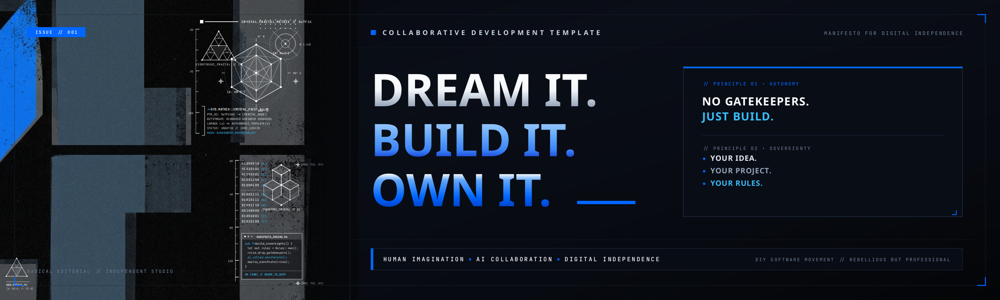

# Collaborative Development Template

A project-agnostic framework for structured, secure, AI-assisted software development.

## For AI assistants

If a user shares this repository URL to begin a project, treat the link itself as the request to use this template. Read `START_HERE.md` from the current default branch before replying. The current repository state takes precedence over stale branch names or handover details from earlier conversations; use another branch only when the user explicitly requests it. Then make your entire first response only a natural, concise equivalent of **“What are you dreaming of?”** in the user's language. Do not ask the user to explain the repository, name a branch, or provide a separate instruction to read the guide. If you cannot access the repository or read the guide, say so honestly; do not pretend you have loaded it.

## Start a project

Share this repository link with ChatGPT as the starting point. When ChatGPT can access the repository, it should begin with the opening question above—not a setup explanation or questionnaire.

The guide then helps you explore your idea, shape a project brief, choose an appropriate technical direction, set up a safe workflow, and build in manageable steps. You do not need to know how to code to begin. When the project is ready to build, the guide pauses for a private-by-default GitHub setup, including commit-email privacy checks, before implementation starts.

- [Start here: AI project guide](START_HERE.md)
- [Private GitHub project setup guide](docs/PRIVATE_GITHUB_SETUP.md)
- [ChatGPT onboarding guide](CHATGPT_ONBOARDING.md)
- [Onboarding acceptance test](docs/ONBOARDING_ACCEPTANCE_TEST.md)
- [Project brief template](PROJECT_BRIEF_TEMPLATE.md)
- [Project memory template](PROJECT_MEMORY_TEMPLATE.md)
- [Decision log template](DECISION_LOG_TEMPLATE.md)
- [Risk register template](RISK_REGISTER_TEMPLATE.md)
- [Research template](RESEARCH_TEMPLATE.md)
- [Milestone plan template](MILESTONE_PLAN_TEMPLATE.md)
- [Development workflow](docs/DEVELOPMENT_WORKFLOW.md)
- [Review checklist](docs/REVIEW_CHECKLIST.md)
- [Handover template](docs/HANDOVER_TEMPLATE.md)
- [Current project handover](docs/PROJECT_HANDOVER.md)
- [Incident response playbook](INCIDENT_RESPONSE.md)
- [Security policy](SECURITY.md)
- [Project risk and release readiness standard](PROJECT_RISK_AND_RELEASE_READINESS.md)
- [Update and release security policy](UPDATE_AND_RELEASE_SECURITY.md)
- [Privacy and public publication standard](PRIVACY_AND_PUBLICATION.md)
- [Contributor guide](CONTRIBUTING.md)
- [AI and contributor repository instructions](AGENTS.md)

## The template's five priorities

The template is designed and maintained in this strict priority order:

1. **Safety** — protect users, contributors, their data, their devices, and the integrity of the project. Prevent avoidable harm, malicious code, unsafe dependencies, and insecure release practices.
2. **Legal solidity** — identify and meet applicable legal, regulatory, privacy, consumer, intellectual-property, and licence obligations. Do not claim legal compliance without adequate evidence and qualified review where needed.
3. **Usability** — make the safe and legally responsible path clear, understandable, accessible, and practical. Reduce friction without silently weakening safeguards or hiding material information.
4. **Trust** — earn and preserve trust through honest communication, transparency, predictable behavior, respect for user choice, and evidence-backed claims.
5. **Freedom** — preserve user autonomy, choice, ownership, portability, and control over their projects, data, tools, and workflows. Prefer open standards and interoperability; avoid unnecessary lock-in, restrictions, telemetry, or imposed technical and commercial choices.

Freedom operates within the necessary boundaries of safety and applicable law. Prefer the least restrictive effective safeguard, explain meaningful constraints, and preserve user choice wherever doing so does not create unacceptable harm or legal exposure.

When these priorities conflict, evaluate them in this order. Usability improvements must not bypass necessary safety or legal controls. Trust is earned by consistently delivering on the first three priorities; it must never be manufactured through reassuring language or unsupported promises. Freedom is protected within necessary safety and legal boundaries, using the least restrictive effective safeguards and preserving user autonomy wherever possible. Apply the priorities proportionately so that small projects receive practical guidance rather than unnecessary bureaucracy.

## Important note about the GitHub link

Sharing a repository URL does not guarantee that every ChatGPT configuration can browse or modify GitHub. The assistant must be honest about its access. If it cannot read the repository, provide the contents of `START_HERE.md` or paste the fallback instruction from that guide. Repository changes require an available, authorized GitHub connection or actions by the user.

## Privacy-first publication

This repository is public. Never add personal, private, confidential, or identifying information belonging to contributors, collaborators, or third parties.

- Use fictional identities and placeholder values in all examples.
- Never commit credentials, tokens, private keys, personal contact details, private conversation excerpts, private repository URLs, or confidential project material.
- Review files, screenshots, logs, examples, commit content, and document metadata before publication.
- Do not copy material from private projects or conversations into this template. Generalize and sanitize reusable lessons first.
- If sensitive information is exposed, follow [the incident response playbook](INCIDENT_RESPONSE.md), revoke affected credentials immediately, and assess whether Git history and distributed copies require remediation.

## Status

The core foundation and practical starter pack are available on the default branch.

The `START_HERE.md` onboarding guide is present on `main`. Its content has been inspected directly on the default branch. A genuine fresh-conversation test is still required to verify that a new ChatGPT conversation discovers the guide from the repository URL and follows the required first-response behavior. Do not treat file availability as proof of successful onboarding.

The latest inspected visual-identity pull request (#3) passed its Repository Hygiene and Gitleaks checks. These automated checks do not constitute a complete security audit or legal review.

The template remains under active review. See [the project handover](docs/PROJECT_HANDOVER.md) and [the onboarding acceptance test](docs/ONBOARDING_ACCEPTANCE_TEST.md) for current findings and limitations.

## Licence

This project is licensed under the [MIT License](LICENSE). The licence applies to the project material covered by the repository; third-party components and contributions remain subject to their own applicable rights and notices.
